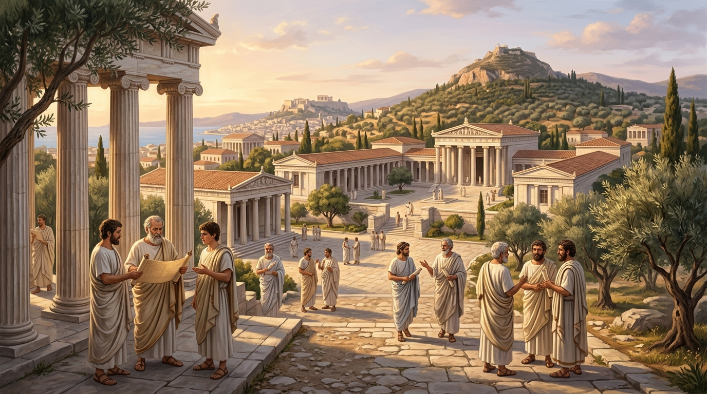

# FOPOS — Felsefe Öğretmenleri Platformu (TYMM 2026 Uyumlu)



**FOPOS**, felsefe öğretmenleri ve lise öğrencileri için geliştirilmiş; **T.C. Millî Eğitim Bakanlığı Türkiye Yüzyılı Maarif Modeli (TYMM 2026)** Felsefe Dersi Öğretim Programı ile %100 uyumlu, etkileşimli düşünce laboratuvarı ve öğretim platformudur.

---

## 🌟 Öne Çıkan Özellikler

1. **Düşünce Deneyleri Laboratuvarı (Thought Experiments Lab)**
   - Vagon İkilemi (*Trolley Problem*), Theseus'un Gemisi, Platon'un Mağarası, Rawls'un Bilgisizlik Peçesi, Searle'ün Çin Odası ve Eko-Etik İkilemi.
   - İnteraktif simülasyonlar, anlık parametre değiştirme, felsefi argüman analizi ve canlı sınıf oylaması.

2. **Sokratik Diyalog Simülatörü (Socratic Arena)**
   - Sokrates, Immanuel Kant, Friedrich Nietzsche, İbn Sînâ ve Baruch Spinoza yapay zekâ karakterleri.
   - Sokratik sorgulama (Elenkhos), kavram doğurtma (Maiotik) ve mantıksal safsata (fallacy) takipçisi.

3. **Argüman Haritalama Aracı (Argument Mapping Builder)**
   - Öncül-iddia-karşıt iddia ağaçları, hazır klasik kanıt şablonları (Descartes Cogito, Anselmus Ontolojik Kanıt, Kant Ödev Ahlakı) ve metin aktarımı.

4. **TYMM 2026 Müfredat & P4C Stüdyosu**
   - **10. Sınıf (9 Temel Alan):** Felsefenin Doğası, Mantık ve Argümantasyon, Varlık, Bilgi, Ahlak, Estetik ve Sanat, Siyaset, Din, Bilim felsefeleri.
   - **11. Sınıf (6 Çağdaş Tematik Ünite):** Çevre Sorunları ve Felsefe, Teknoloji ve Hayat, Akıl ve İnanç, Edebiyat ve Felsefe, Hayatın Anlamı, Hukuk ve Felsefe.
   - Süreç bileşenleri, alan becerileri (**SBAB13**, **SBAB14**, **SBAB15**), değerler (**D**), okuryazarlıklar (**OB**) ve farklılaştırma (zenginleştirme / destekleme).
   - 40 dakikalık modüler P4C ders planı oluşturucu.

5. **Resmî TYMM Ölçme Rubrikleri (Ek 1 & Ek 2)**
   - **Ek 1:** Felsefi Metin İnceleme Dereceli Puanlama Anahtarı (100 Puan)
   - **Ek 2:** Felsefi Metin Yazımı Dereceli Puanlama Anahtarı (100 Puan)
   - İnteraktif puan hesaplama, geri bildirim notları ve doğrudan A4 baskı / PDF çıktısı alma.

6. **Akıllı Tahta & Projeksiyon Modu**
   - Pardus ve Windows etkileşimli tahtalar için dokunmatik optimize büyük arayüz.
   - 3 dakikalık münazara/tartışma sayacı ve canlı sınıf el kaldırma oylama paneli.
   - Sınıf içi anlık paylaşım için dinamik **QR Kod**.

---

## 🚀 Kurulum ve Yerel Çalıştırma

Projeyi bilgisayarınızda veya okul sunucusunda çalıştırmak için:

### 1. Gereksinimler
- Node.js (v18 veya üzeri önerilir)
- npm veya bun

### 2. Depoyu Klonlayın
```bash
git clone https://github.com/KULLANICI_ADINIZ/fopos-tymo.git
cd fopos-tymo
```

### 3. Bağımlılıkları Yükleyin
```bash
npm install
```

### 4. Çevre Değişkenleri (.env)
Kök dizindeki `.env.example` dosyasını `.env` olarak kopyalayın:
```bash
cp .env.example .env
```
*(Yapay zekâ özellikleri için Google AI Studio'dan alacağınız ücretsiz `GEMINI_API_KEY` anahtarını ekleyin. Anahtar olmadan da tüm simülasyonlar, rubrikler ve müfredat içerikleri yerel motorla eksiksiz çalışır.)*

### 5. Uygulamayı Başlatın
```bash
npm run dev
```
Tarayıcınızda `http://localhost:3000` adresine giderek uygulamayı kullanmaya başlayabilirsiniz.

### 6. Üretime (Production) Derleme
```bash
npm run build
npm start
```

---

## 🛠 Kullanılan Teknolojiler

- **Frontend:** React 19, TypeScript, Vite, Tailwind CSS v4, Lucide React, Motion
- **Backend:** Express.js, Node.js, `@google/genai` SDK
- **Ölçme & Araçlar:** HTML5 Canvas, QR Code Generator, Web Print API

---

## 📄 Lisans
Bu proje eğitim amaçlı geliştirilmiş olup açık kaynak lisansı altındadır.
Türkiye Yüzyılı Maarif Modeli (TYMM) Felsefe Dersi Öğretim Programı kazanımları ve resmî rubrikleri T.C. Millî Eğitim Bakanlığı yönergeleriyle uyumludur.
